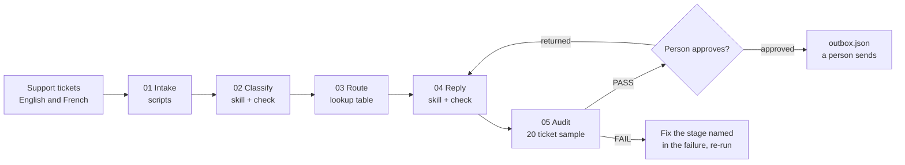

# Bilingual support triage with ICM

A Claude skill plus an ICM workspace that triages English and French support tickets. It reads each ticket, picks a category and a priority, routes it to one team, drafts a short reply in the ticket's own language, audits a sample, and then stops. A person approves every reply. Nothing is ever sent.

**Live demo:** https://josh3311.github.io/bilingual-triage-icm/ (no sign in, no tokens used)

## Why this exists

Bilingual support teams get tickets in English and French all day. A single chat with an AI can handle one ticket, but with a whole batch it silently drops tickets, mixes languages, and promises refunds nobody approved. This project shows a different way to build it: split the work into five small stages, let scripts do every job that has an exact answer, let Claude do only the jobs that need reading and writing, and put a person at the gate.

## Who it is for

Support leads, and anyone building AI workflows that must be checkable. It is also a worked example of ICM (Interpreted Context Methodology): numbered folders, one `CONTEXT.md` per stage, and scripts that count.

## How it works



| Stage | Folder | Handled by | What it does |
|---|---|---|---|
| 1 | `01_intake` | Scripts | Checks every field, rejects bad tickets with a reason, tags EN or FR by counting words |
| 2 | `02_classify` | Skill `triage-ticket`, then a script | Picks 1 of 6 categories and 1 of 3 priorities, flags `needs_human` |
| 3 | `03_route` | Script and `data/routing_table.json` | One category gives exactly one team. An unknown category stops the run |
| 4 | `04_reply` | Skill `draft-reply`, then a script | Writes 3 to 5 sentences in the ticket's language. The script rejects promises, wrong language and leaked team names |
| 5 | `05_audit` | Script | Audits 20 tickets chosen with a fixed seed, 7 checks each. PASS needs 20 of 20 |
| Gate | outside the stages | A person | Approves or returns. `export_approved.py` refuses unless the audit passed |

Every stage folder has a `CONTEXT.md` with the same seven sections: task, inputs, skills, scripts, done when, do not, next stage. `CLAUDE.md` at the root is the map.

## What is different

- **Scripts count, skills think.** Language tagging, routing, banned phrases and the audit are plain code, so they cannot hallucinate.
- **A failed audit names the stage to fix**, not just "something is wrong".
- **No sending tool exists in the project.** A person copies approved drafts into the real support system.
- **Deterministic audit.** The same seed gives the same 20 tickets in Python and in the browser.

## About the demo, honestly

The website replays one **recorded Claude run**: the classifications and the drafts in `runs/2026-11-15_01/` were written by Claude following the two skills in `skills/`. The checks are not recorded. The language tagging, validation, routing, reply checks and the audit run **live in your browser** from `docs/triage.js`, a JavaScript copy of the Python scripts. A test proves the two give the same answers.

Try the **Try to break it** button. It changes one ticket's team and the audit fails and points at `03_route`.

There is also an optional panel to run one ticket live with **your own Anthropic API key**. It is off by default, the key stays in memory only, calls go straight from your browser to `api.anthropic.com`, and you pay for them yourself. Visitors never need it. Because it calls the API from the browser, treat any key you paste there as something you may want to rotate afterwards.

All 30 tickets are invented. No real customer data is in this repository.

## Run it yourself

Needs Python 3.10 or newer. No packages to install.

```bash
python3 scripts/run_intake.py 2026-11-15_01     # stage 1
python3 scripts/check_classification.py 2026-11-15_01
python3 scripts/route_ticket.py 2026-11-15_01
python3 scripts/check_reply.py 2026-11-15_01
python3 scripts/audit_sample.py 2026-11-15_01    # AUDIT PASS 20/20
python3 -m unittest discover -s tests -v          # 21 tests
```

To rebuild the website data after a new run: `python3 scripts/build_site_data.py <run_id>`. To view the site locally: `python3 -m http.server -d docs` and open http://localhost:8000.

To run it with Claude for real, open this folder as a Claude Code workspace, copy `skills/` into your skills folder, and have Claude work through the stages in order, running each stage's scripts as written in its `CONTEXT.md`.

## Known limits

- Language tagging counts words, so very short or mixed language tickets can come out `low` confidence. Those are marked, not hidden.
- The reply check looks for team names and priority labels. The skill also forbids category names, but no script enforces that yet.
- The recorded run is one run on synthetic tickets, not a measurement of accuracy on real support data.

## Layout

```
CLAUDE.md             the map
01_intake ... 05_audit  one folder per stage, each with CONTEXT.md
skills/               triage-ticket and draft-reply
scripts/              the checks, Python standard library only
data/                 categories, routing table, word lists, 30 sample tickets
runs/                 one folder per run, one JSON file per stage
docs/                 the GitHub Pages site and its architecture notes
tests/                unit tests, a JS parity test, a browser test
```
