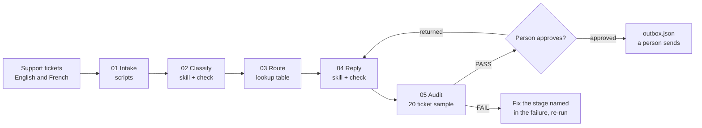
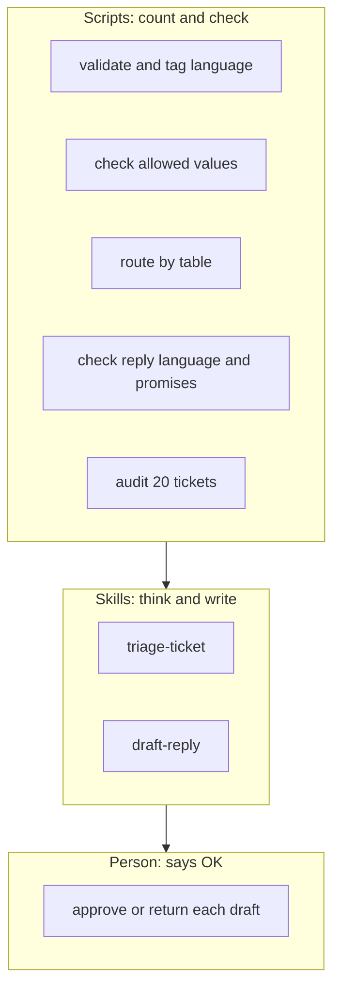

## Architecture

Five stages, one folder each. Scripts count and check, skills think and write, and a person approves before anything leaves. The workspace has no sending tool.

### Who does what

| Stage | Folder | Handled by | Output file |
|---|---|---|---|
| 1 | `01_intake` | Scripts | `01_intake.json` |
| 2 | `02_classify` | Skill `triage-ticket`, then a check script | `02_classify.json` |
| 3 | `03_route` | Script and `routing_table.json` | `03_route.json` |
| 4 | `04_reply` | Skill `draft-reply`, then a check script | `04_reply.json` |
| 5 | `05_audit` | Script | `05_audit.json` |
| Gate | outside the stages | A person | `outbox.json` |
